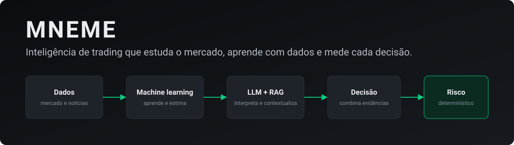

<p align="center">
  
</p>

<p align="center">
  
  
  
  
</p>

---

**MNEME** é um projeto para construir uma inteligência de trading: estudar mercados, aprender com dados históricos, testar estratégias, identificar oportunidades e gerar sinais, com execução apenas depois de resultado medido no simulado.

A ideia central é uma arquitetura híbrida, em que cada parte faz o que faz melhor:

| Parte | Papel |
|---|---|
| **Machine learning** | Aprende com os dados e estima resultados |
| **LLM e RAG** | Interpretam texto e contextualizam, com modelo local e sem decidir ordens |
| **Quantitativo** | Calcula, testa e valida com dados que o modelo nunca viu |
| **Decisão** | Combina as evidências em regras versionadas e mensuráveis |
| **Risco** | Código determinístico que nenhum outro módulo contorna |

## O que já funciona

- **Coleta de velas de 1 minuto** de BTC, ETH e SOL: histórico público, WebSocket ao vivo e recuperação automática de lacunas. Cada vela guarda a hora em que chegou, para reconstruir o que o sistema sabia em cada momento.
- **Indicadores** (RSI, MACD, Bollinger, ATR, ADX, OBV, VWAP, médias e delta de volume), conferidos com o TA-Lib em dados reais.
- **Leitura de mercado:** tendência, estrutura de topos e fundos, suporte e resistência, rompimentos, consolidação e padrões de vela, com um teste garantindo que nada olha o futuro.
- **Estratégia "seguir traders" no simulado:** mede o acerto de cada trader e entra quando a maioria dos de alto acerto compra, com taxa e slippage.
- **Pesquisa medida:** nove setups testados em anos de velas e modelos com validação walk-forward. Resultado até aqui: só velas não bastam para prever direção com folga, e um setup segue em teste ao vivo. Os números estão em [`robo/conhecimento/setups.md`](robo/conhecimento/setups.md).
- **Site** no Cloudflare Pages com gráfico, painel e Configurações, e **dicas no Telegram**.

A coleta roda em Docker Compose numa máquina ARM64 gratuita da Oracle (2 OCPU, 12 GB).

## O que vem depois

Ordem de implementação completa no [roadmap](docs/architecture/ROADMAP.md):

1. Dados de fluxo: trades, livro de ofertas, funding e open interest.
2. Backtest e validação com purga e embargo.
3. Modelos LightGBM e XGBoost treinados com histórico.
4. Decision Engine, Risk Engine e paper trading por estratégia.
5. Sinais com ciclo de vida e avaliação automática.
6. Knowledge Engine com RAG, notícias, calendário econômico, Ollama e LangGraph.
7. Ciclo de aprendizado: hipótese, experimento e comparação.
8. Execução real controlada.

## Desenvolvimento

O robô fica em [`robo/`](robo/LEIA-ME.md), com Python e [uv](https://docs.astral.sh/uv/):

```bash
cd robo
uv sync
uv run pytest -q
uv run python -m mneme.dados importar --meses 24
uv run python -m mneme.dados ler BTCUSDT --tempo 15min
```

Site e Worker, em TypeScript:

```bash
npm install
npm test
npm run typecheck
```

Copie `.env.example` para `.env` e preencha só o que for usar. **Chaves e endereços privados ficam no `.env`, que nunca entra no Git.** Um push na `main` publica o site e o Worker pelo GitHub Actions.

## Documentação

| | |
|---|---|
| [Visão geral da arquitetura](docs/architecture/SYSTEM_OVERVIEW.md) | Módulos, contratos e fluxos |
| [Análise crítica](docs/architecture/ANALISE_CRITICA.md) | Por que híbrido, alternativas e limitações |
| [Roadmap](docs/architecture/ROADMAP.md) | Ordem de implementação e critérios |
| [Machine learning](docs/architecture/MACHINE_LEARNING_ARCHITECTURE.md) | Treino, validação e promoção de modelos |
| [Oracle Always Free](docs/architecture/ORACLE_ALWAYS_FREE_DEPLOYMENT.md) | Implantação e medições de LLM local em ARM64 |
| [Decisões (ADRs)](docs/architecture/ADR/README.md) | O que foi decidido e por quê |
| [O robô atual](docs/robo.md) | Estratégia de seguir traders e configurações |
| [Cloudflare](docs/cloudflare.md) | Pages, Worker, D1 e publicação |

O bot em `src/` e o Worker em `workers/bot/` são legado: só recebem correções.

---

<sub>Projeto pessoal e de estudo. Não é recomendação de investimento: desempenho passado não garante resultado futuro, e operar criptoativos pode causar perdas. © Thiago Antunes. Todos os direitos reservados.</sub>
