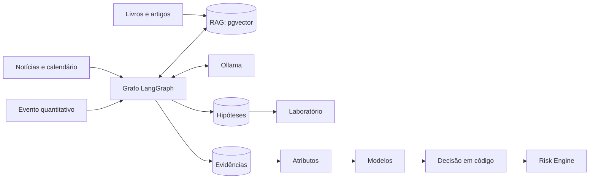
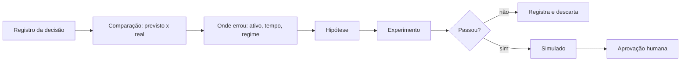

# Análise crítica da visão

**Situação:** primeira entrega do direcionamento, aguardando aprovação. Responde às 15 perguntas do dono.

## Conclusão em poucas linhas

- A visão híbrida está certa, e cada técnica cobre um ponto que a outra não cobre.
- A divisão mais importante é: **o LLM entende e explica; o ML mede e estima; o código decide e protege.**
- A infraestrutura gratuita aguenta o MVP. O limite real não é memória, e sim a **qualidade do LLM pequeno** e o **tamanho das amostras**.
- O maior risco para o resultado é a hipótese central: pode não haver vantagem depois dos custos. A arquitetura é feita para descobrir isso gastando pouco.

## Onde discordo da visão

| Pedido ou ideia | Problema | O que proponho |
|---|---|---|
| "Ver a notícia, entender e operar" | Em retrospectiva parece óbvio, mas eleições e decisões raras têm poucos casos. O Fed tem cerca de 8 reuniões por ano, ou seja, cerca de 80 em uma década | Eventos raros geram aviso; só eventos frequentes e medidos geram sinal |
| LLM pequeno interpretando e raciocinando | Na medição, os modelos acertaram de 1 a 2 tipos em 5 e erraram com instrução maliciosa | Regras e listas fechadas primeiro; LLM como apoio, sempre medido |
| Coordenador que consolida e decide | Se for LLM, não dá para medir nem reproduzir, e na A1 levaria dezenas de segundos | Coordenador em código; LLM explica depois |
| "Trader autônomo" | Autonomia não cria vantagem; ela só executa o que já existe. Os estudos internos ainda não acharam vantagem robusta | Autonomia só depois da promoção |
| Sinais com EUR/USD na Quotex | Sem cotação nem payout oficiais | Sinal medido em referência |
| Aprender como "um trader de Wall Street" | Parte do que eles usam depende de dados caros, latência e capital | Estudar método e testar o que for possível; declarar o resto como inviável |
| Deep learning e RL cedo | Pouca evidência de ganho nessa escala; dados e simulador vêm antes | Só depois de superar as referências |

## 1. A arquitetura híbrida é a melhor solução?

Sim, com o LLM fora da decisão.

| Alternativa | Vantagens | Desvantagens | Veredito |
|---|---|---|---|
| Só regras | Simples, barata, auditável | Não lê texto nem combina muitas variáveis | Base, insuficiente |
| Só ML quantitativo | Mede e estima | Não entende notícias novas | Núcleo, insuficiente |
| Só LLM | Lê tudo, fácil de demonstrar | Inventa, não é reproduzível, caro ou lento, vazamento de futuro | **Recusada**: é o "chatbot fantasiado" |
| Híbrida com LLM decidindo | Flexível, parece inteligente | Não se mede; risco de injeção; latência | Recusada |
| **Híbrida com núcleo determinístico** | Cada parte faz o que faz bem; funciona sem LLM; tudo medido | Mais módulos; eventos raros não geram operação | **Escolhida** |

## 2. Papel exato do LLM

**Faz:** extrair dados de texto para um esquema fixo; resumir; responder com RAG; explicar uma decisão a partir de números prontos; sugerir hipóteses para teste; coordenar ferramentas nos fluxos analíticos.

**Não faz:** dar preço, direção, tamanho, probabilidade ou ordem; aprovar risco; alterar regras; ver segredos.

Ele é acionado só por evento e roda por Ollama. Ver [medição](ORACLE_ALWAYS_FREE_DEPLOYMENT.md).

## 3. Papel exato do Machine Learning

Estimar o que pode ser medido, separado por mercado: probabilidade de movimento, alvo antes do stop, volatilidade, regime, qualidade da entrada e risco do token.

| Tipo | Uso |
|---|---|
| Supervisionado (LightGBM, XGBoost) | Núcleo |
| Não supervisionado (agrupamento, HMM) | Descobrir regimes e detectar anomalias, com utilidade medida |
| Calibração | Transformar pontuação em probabilidade confiável |

Responde às perguntas do pedido, como "qual a relação entre RSI, VWAP, volume e o que vem depois?", com dados históricos e testes fora da amostra.

## 4. Como o Deep Learning pode contribuir

| Uso | Quando | Onde |
|---|---|---|
| Embeddings para RAG (já é deep learning) | MVP | A1, em CPU |
| Modelo pequeno de sentimento financeiro | Fase 5, se superar as regras | A1 |
| TCN ou LSTM em dados de alta frequência | Depois da fase 6, com muitos dados de fluxo | Treino externo |
| Transformers de séries | Só com ganho comprovado | Treino externo |

Em dados tabulares de tamanho moderado, árvores costumam competir bem com redes neurais. A regra é a do próprio pedido: só entra com resultado medido contra a referência simples.

## 5. Como GenAI, RAG e LangGraph se integram

- **LangGraph** organiza os passos, com estado e retomada.
- **RAG** dá o contexto. Não é treinamento.
- **GenAI** escreve resumos, explicações e hipóteses.

**Alternativas ao LangGraph:** código próprio é mais leve, mas exige reescrever checkpoints e retomada; CrewAI e similares focam em conversa entre agentes, justamente o que o pedido quer evitar. LangGraph é MIT e leve o bastante, ficando fora do caminho da ordem.

## 6. Como aprende com velas, indicadores e resultados

1. Coleta com hora de chegada.
2. Calcula atributos só com o passado.
3. Define rótulos, como retorno futuro ou alvo antes do stop.
4. Treina em uma janela e testa à frente, com purga e embargo.
5. Compara com referências simples, descontando custos.
6. Roda no simulado, ao vivo.

O sistema aprende com os dados, não pela leitura sobre RSI. Saber o que é RSI ajuda a escolher hipóteses, e os dados mostram se ele serve.

## 7. Como estudar estratégias de traders profissionais

Duas fontes, com tratamentos diferentes:

- **Métodos (livros, artigos):** RAG → regra formal → teste. Regra subjetiva demais é marcada como "não testável".
- **Comportamento medido (provedor de sinais):** operações reais dos traders, com acerto e retorno medidos, inclusive perdas não realizadas. O meta-labeling aprende quando vale segui-los.

Ver [KNOWLEDGE_ENGINE](KNOWLEDGE_ENGINE.md). Nada é aceito só por ser famoso.

## 8. Como interpretar notícias e macro

As 12 etapas estão em [KNOWLEDGE_ENGINE](KNOWLEDGE_ENGINE.md), e o calendário está em [MARKET_DATA_ENGINE](MARKET_DATA_ENGINE.md).

**Calendário econômico:** o Investing.com não entra de forma automática: não tem API pública, respondeu 403 na A1, e o aviso do site restringe o uso. O calendário é montado com agendas oficiais, testadas da A1. O consenso depende de uma fonte com termos conferidos.

Pontos que importam:

- **Surpresa:** resultado contra expectativa, e não só o número.
- **Já precificado:** quanto o preço andou desde o fato, em relação à volatilidade normal.
- **Tipo da informação:** fato, preliminar, rumor, opinião, previsão, interpretação.

## 9. Como combinar qualitativo e quantitativo

| Forma | Como | Exemplo |
|---|---|---|
| Atributo | Texto vira número com hora | `surpresa_cpi`, `minutos_ate_fomc`, `tema_juros` |
| Filtro | Evento bloqueia ou libera, por regra medida | Sem entradas perto de um dado forte |
| Estudo de eventos | Mede a reação por tipo | CPI acima do esperado contra BTC |
| Contexto | RAG explica, sem decidir | Justificativa do sinal |

**Divergência:** se as evidências se contradizem, o coordenador reduz a qualidade da evidência ou não opera, por regra escrita.

## 10. Como gerar sinais com evidência estatística

Um sinal só sai de estratégia promovida. Traz o resultado histórico fora da amostra, o tamanho da amostra e o resultado ao vivo. A probabilidade só aparece com calibração válida. Sem isso, fica vazia, de propósito.

O estado "sem oportunidade" é tratado como resultado normal. Ver [SIGNAL_ENGINE](SIGNAL_ENGINE.md).

## 11. Como aprende com operações anteriores

O modelo não muda sozinho a cada operação, porque isso aprenderia ruído. O LLM pode propor a hipótese, mas quem aprova é o processo.

## 12. O que é necessário no MVP

**MVP proposto:** sistema de sinais auditáveis no simulado, com leitura de calendário e notícias como informação. Corresponde às fases 0 a 3, mais uma parte das fases 4 e 5.

| Entra | Fica para depois |
|---|---|
| Docker Compose, backup, monitor | Grafana |
| Robô atual migrado para a A1 | |
| Coleta de velas, trades, livro, funding, OI | Mais pares |
| Calendário por fontes oficiais | Consenso global, se os termos não permitirem |
| Postgres + Parquet | Qdrant, Timescale, Kafka |
| Laboratório com validação correta | CPCV completo |
| LightGBM e XGBoost no meta-labeling | Deep learning, RL |
| Risk Engine e kill switch | |
| Sinal com ciclo de vida no Telegram | Modo CONFIRMATION |
| RAG mínimo, com Ollama sob demanda | LangGraph completo, com 11 agentes |
| Simulado | **Dinheiro real** |

## 13. O que roda de graça na Oracle

Coleta, atributos, banco, Parquet, inferência de árvores, sinais, simulado, backtest moderado, RAG, embeddings e LLM pequeno sob demanda. O detalhe de memória está em [ORACLE_ALWAYS_FREE_DEPLOYMENT](ORACLE_ALWAYS_FREE_DEPLOYMENT.md).

## 14. O que roda fora

| Trabalho | Onde | Custo |
|---|---|---|
| Otimização e validação extensas | Máquina do dono | Zero |
| Deep learning e RL | Máquina do dono ou GPU grátis de terceiros | Zero, com limites e termos a conferir |
| LLM maior para estudos em lote | Máquina do dono, com Ollama | Zero |
| Cópia de backup | Máquina do dono | Zero |

Isso exige que a máquina do dono esteja disponível. A operação na A1 não depende dela.

## 15. Limitações a considerar

### Técnicas

- 2 OCPU: LLM e carga pesada competem com a coleta. Por isso, há limites e prioridades.
- LLM pequeno: baixa qualidade medida; sem raciocínio longo em tempo real.
- Latência: de segundos a um minuto. Não dá para competir em alta frequência.
- Amostras: eventos raros não sustentam probabilidade.
- Sem cotação da Quotex.
- Disco: 142 GB na A1, e nenhum volume novo relevante.

### Financeiras

- Provedor de sinais cobra crédito; é o único custo atual obrigatório para a estratégia de seguir traders.
- Algumas fontes úteis são pagas, sem substituto gratuito à altura: consenso global licenciado, redes sociais, dados de livro históricos. Alternativa: coletar desde já, medir com o que é permitido, e declarar a limitação.
- Conta da Oracle agora pode gerar cobrança.

### De resultado

Nenhuma arquitetura cria vantagem onde ela não existe. Os estudos atuais mostram o curto prazo quase aleatório. É possível que, ao final da fase 6, a resposta honesta seja: "ainda não há vantagem para capital real".

## Como a evolução pedida se liga ao roadmap

| Etapa do pedido | Fases | Diferença |
|---|---|---|
| 1. Estudar e interpretar | 1, 4, 5 | **A coleta começa antes**, porque dado não coletado se perde |
| 2. Consultar conhecimento | 4 | |
| 3. Aprender com histórico | 2, 6 | |
| 4. Validar | 2 | O laboratório vem antes dos modelos, para evitar conclusões falsas |
| 5. Paper trading contínuo | 0 em diante | Já existe e continua |
| 6. Operar de verdade | 8, 9 | Só com aprovação |
| 7. Evoluir continuamente | Todas | |

Cada etapa entrega algo verificável. Ver [ROADMAP](ROADMAP.md).
