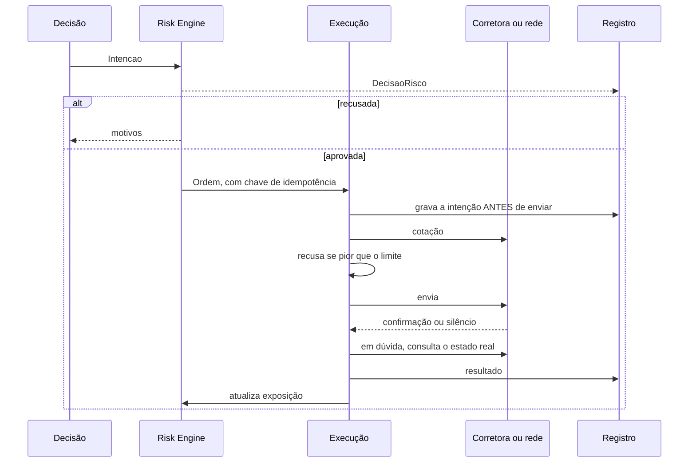

# Execution Engine

**Situação:** proposta aguardando aprovação. Hoje o robô Python só simula.

## O que cada mercado permite

| Mercado | Dados | SIGNAL ONLY | CONFIRMATION | AUTONOMOUS | Motivo |
|---|---|---|---|---|---|
| Solana (Jupiter) | Sim | Sim | Depois da promoção | Depois da promoção | API documentada, chave local |
| Binance Spot | Sim | Sim | Depois da promoção | Depois da promoção | API oficial, com chave restrita |
| Binance Futuros | Só leitura | **Não** | **Bloqueado** | **Bloqueado** | Fora do escopo de execução |
| Forex e opções digitais na Quotex | Sim, em fonte de referência | Sim | **Não** | **Não** | Sem API oficial encontrada |
| Forex em outra corretora | - | - | - | - | Fora de escopo até nova decisão |

Essa matriz fica em configuração, e o código recusa o que estiver bloqueado. Abrir uma célula bloqueada exige um novo ADR, e não basta uma mudança na tela.

### Quotex

- **Integração:** nenhuma API oficial foi encontrada. O site não pôde ser lido daqui, então os termos não foram conferidos diretamente. Fontes secundárias dizem que não há API pública, e [uma biblioteca não oficial cita uma mensagem atribuída à corretora](https://pypi.org/project/quotexpy/1.40.1) sobre bloqueio de contas por uso de robôs.
- **Decisão:** nenhum executor. Conforme o próprio pedido, sem automação de navegador, engenharia reversa ou endpoints privados. Sinais e execução ficam separados, e a execução fica de fora.

### Binance Futuros

Os dados públicos servem de atributos, como funding e open interest. A execução fica bloqueada neste projeto.

## Modos

| Modo | Analisa | Sinal | Pede aprovação | Executa |
|---|---|---|---|---|
| SIGNAL ONLY | Sim | Sim | Não | Não |
| CONFIRMATION | Sim | Sim | Sim | Só depois de aprovado |
| AUTONOMOUS | Sim | Sim | Não | Sim, dentro dos limites |

Configurado por **mercado e modalidade**, na tela de Configurações. O padrão é SIGNAL ONLY. Um dado ausente ou inválido derruba o modo para SIGNAL ONLY, nunca o contrário. Ativar o modo real exige, em conjunto: chave no servidor, aprovação na tela, estratégia em nível 4 ou acima e todos os limites preenchidos.

## Fluxo



## Porta e adaptadores

```python
class Executor(Protocol):
    def cotar(self, ordem: Ordem) -> Cotacao: ...
    def executar(self, ordem: Ordem) -> Execucao: ...
    def estado(self, chave: str) -> Execucao | None: ...
    def saldos(self) -> Saldos: ...
```

| Adaptador | Situação | Observações |
|---|---|---|
| `ExecutorSimulado` | Evolução de `carteira.py` | Custo por mercado e carteira por estratégia |
| `ExecutorJupiter` | Portar do legado | Swap V2. O plano grátis tem [1 requisição por segundo](https://developers.jup.ag/docs/portal/faq), e Ultra foi descontinuada |
| `ExecutorBinanceSpot` | Novo | Ordem limitada com proteção; `newClientOrderId` como idempotência |

## Garantias

| Garantia | Como |
|---|---|
| Sem ordem duplicada | Chave única por decisão, gravada antes do envio, com restrição `UNIQUE` |
| Resultado desconhecido | Bloqueia novas ordens no ativo até reconciliar com a rede ou a corretora |
| Reinício | Reconcilia saldos e ordens antes de abrir qualquer entrada |
| Saídas | Continuam quando as entradas param, com mais tolerância a slippage. Exceção: kill switch, que tem regra própria |
| Cotação | Recusa antes de assinar, se pior que o limite |
| Limite de chamadas | Fila única por corretora, respeitando o limite |

## Segredos e chaves

- Carteira e subconta **dedicadas**, com o mínimo de saldo. Chave nunca no repositório.
- Chave da Binance **sem permissão de saque**, com lista de IP restrita à A1, se a conta permitir.
- Chave Solana local em arquivo com permissão restrita ao serviço. Assinatura local: a chave não sai do processo.
- Logs nunca recebem chaves.

## Antes do primeiro real

1. Testes com falhas simuladas: silêncio, erro, resposta parcial, reinício no meio da ordem.
2. Binance: rodar na [testnet Spot](https://developers.binance.com/en/docs/products/spot/testnet/web-socket-api).
3. Solana: menor valor possível, com saída imediata para testar o ciclo completo.
4. Kill switch testado com posição real mínima.
5. Comparar custo real com o simulado e ajustar o modelo.
6. Aprovação explícita do dono, registrada, para cada mercado.
