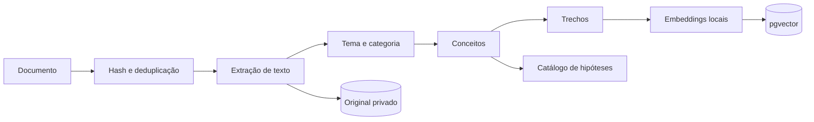

# Knowledge Engine: RAG e inteligência de notícias

**Situação:** referência de arquitetura, subordinada ao [Product Charter](../PRODUCT_CHARTER.md). O estado real está em [RASTREABILIDADE.md](RASTREABILIDADE.md).

## Dois sistemas, um limite

- **Base de conhecimento (RAG):** livros, artigos, conceitos, estudos. Muda devagar e serve para **formular hipóteses e explicar**.
- **Notícias e eventos:** fatos datados, que mudam a cada minuto. Viram **atributos e evidências**, com hora.

Nenhum dos dois treina modelo de previsão nem decide operação. O RAG responde "o que se sabe sobre isso"; se funciona, quem diz é o laboratório.

## Pipeline de ingestão



| Etapa | Como |
|---|---|
| Receber | Pasta de entrada ou comando; formatos PDF, Markdown, texto. Anotações e exemplos de operações entram como documentos do dono |
| Extrair | Extrator de PDF; livro escaneado passa por OCR, com qualidade registrada |
| Classificar | Por categoria: indicadores, fluxo, macro, risco, estudo, setup, com o LLM local em lotes fora dos horários de maior uso |
| Conceitos | Extrai regra, condição de uso e limitação |
| Embeddings | `fastembed`, em CPU e local, com modelo multilíngue a validar |
| Armazenar | Postgres + pgvector, com índice HNSW |
| Origem | Documento, página, data, versão, confiabilidade |
| Recuperar | Busca vetorial + texto (`tsvector`) + filtros por categoria, mercado e data |

### Modelo de dados

```text
documentos(id, hash, titulo, autor, tipo, publicado_em, ingerido_em, versao, licenca, confiabilidade, caminho_original)
trechos(id, documento_id, pagina, ordem, texto, embedding, categoria, mercados[])
hipoteses(id, documento_id, trecho_id, regra, condicoes, limitacoes, situacao, experimento_id)
```

`hipoteses.situacao` vai de "não testada" até "aprovada" ou "reprovada", ligada ao experimento. Assim, o RAG responde com o resultado medido ao lado da teoria.

### Consulta contextual

Para "quais estratégias se aplicam com BTC acima da VWAP, RSI em 68 e volume crescente?":

1. Lê os valores reais do momento nos atributos e confere a pergunta com eles.
2. Busca trechos e hipóteses que combinam com o estado.
3. Junta o resultado medido de cada hipótese, por mercado e regime.
4. Responde com fontes, deixando claro o que foi testado e o que não foi.

### Direitos e privacidade

Só entra material legalmente disponível ao dono. Originais e índice ficam na A1, **fora do repositório**. Respostas citam trechos curtos e nunca reproduzem a obra. Em `robo/conhecimento/` continuam só resumos próprios, com fontes.

### Áreas iniciais

Price Action, Smart Money Concepts, Wyckoff, Elliott Wave, Volume Spread Analysis, Market Profile, Order Flow, trend following, reversão à média, momentum, trading quantitativo, arbitragem estatística, gestão de risco e de portfólio, macro e operações em eventos.

Cada método vira regra testável. Quando a regra é subjetiva e não pode ser escrita (alguns usos de Elliott Wave, por exemplo), ela é marcada como **não testável** e não gera sinal. Nada funciona só porque está num livro ou foi usado por alguém famoso.

## Inteligência de notícias

### Fontes iniciais

| Fonte | Uso | Situação medida em 05/11/2026 |
|---|---|---|
| RSS do Fed | Comunicados oficiais | Acessível da A1 |
| BCB | Séries e comunicados | SGS acessível da A1 |
| GDELT DOC 2.0 | Notícias globais, 2017 em diante | **Exige uma consulta a cada 5 s**; a A1 recebeu 429. Só manchetes e metadados; alguns modos limitados a 3 meses |
| Redes sociais | Narrativa | Sem fonte gratuita definida; |
| Calendário econômico | Agenda, consenso e surpresa | Agendas oficiais acessíveis; ver [MARKET_DATA_ENGINE](MARKET_DATA_ENGINE.md) e [ADR-0014](ADR/0014-calendario-economico.md) |

### As 12 etapas

| # | Etapa | Executor | Saída |
|---|---|---|---|
| 1 | Detectar | Coletor | Notícia com `ocorrido_em` e `recebido_em` |
| 2 | Verificar a fonte | Código + tabela de fontes | Confiabilidade |
| 3 | Confirmar data e hora | Código, com outras fontes | Data ou rejeição |
| 4 | Esperado ou surpresa | Agenda, consenso; LLM como apoio | Grau de surpresa |
| 5 | Significado econômico | LLM + RAG, com fontes | Interpretação, sempre marcada como tal |
| 6 | Reações anteriores | Estudo de eventos, com números | Distribuição histórica |
| 7 | Ativos afetados | Lista fechada + LLM | Ativos candidatos |
| 8 | Dados reais | Atributos | Preço, volume, volatilidade atuais |
| 9 | Já precificado? | Compara o movimento desde o fato | Movimento já ocorrido |
| 10 | Cenários | Código, a partir do histórico | Cenários sem probabilidade inventada |
| 11 | Risco e retorno | Código | Razão estimada |
| 12 | Sinal, esperar ou não operar | **Coordenador + Risk Engine** | Decisão |

### Tipos de informação

Toda evidência leva um único tipo: **fato confirmado, informação preliminar, rumor, opinião, previsão ou interpretação do modelo**. Rumor e opinião nunca geram operação sozinhos. Uma notícia isolada nunca vira certeza de movimento.

### Exemplo hipotético

Um candidato assume a liderança inesperadamente numa apuração.

1. O sistema detecta e confirma em mais de uma fonte: **fato confirmado** sobre a apuração, e não sobre o resultado final.
2. Mede a surpresa contra as pesquisas anteriores, quando disponíveis.
3. Consulta como o dólar e o índice reagiram em eventos parecidos, com poucos casos e a incerteza declarada.
4. Olha o que o preço já fez. Se o dólar já caiu 1% em minutos, grande parte do efeito pode já estar no preço.
5. Com poucos eventos comparáveis, **a amostra é pequena demais para uma probabilidade calibrada**. Saída provável: aviso informativo, sem operação, ou sinal só se uma estratégia de eventos já estiver promovida.

Em retrospectiva, um movimento sempre parece óbvio. O teste correto é saber se a regra, escrita **antes**, ganharia em todos os casos parecidos, inclusive naqueles em que o mercado fez o oposto.

### Estudo de eventos

É o que transforma notícia em conhecimento medido: para cada tipo de evento, mede o retorno anormal antes e depois, em várias janelas, com grupo de comparação e correção por múltiplos testes. O resultado alimenta as etapas 6 e 9. Correlação não é tratada como causa: o relatório diz o que foi observado e quantos casos sustentam.

## Segurança

- Texto externo é dado, nunca instrução.
- Nós de LLM não têm ferramentas de ordem nem segredos.
- Saída fora do esquema é descartada.
- Nenhum dado identifica a fonte de sinais em prompts, logs visíveis ou respostas.
