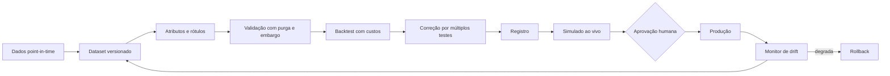

# Arquitetura de machine learning

**Situação:** proposta aguardando aprovação.

## Ponto de partida honesto

O estudo atual já mostrou que só velas de 1 minuto não pagam: 50% a 53% de acerto, contra 54,05% de empate com payout de 85%. Bollinger + RSI em 15 minutos é o único candidato, com folga de 1 a 2 pontos. Portanto, **o ganho precisa vir de informação nova** (fluxo, traders, on-chain, eventos) e de melhores perguntas, antes de modelos mais complexos.

A pesquisa também pede cautela com LLM: em ações, a [previsibilidade por manchetes](https://arxiv.org/pdf/2304.07619v6) cai à medida que o uso se espalha, e [boa parte da vantagem dentro da amostra pode vir de conhecimento do futuro](https://arxiv.org/abs/2309.17322). Em cripto, a evidência encontrada é fraca.

## Papel de cada técnica

| Técnica | Papel | Quando |
|---|---|---|
| Regras e regressão logística | Referência obrigatória | Sempre |
| LightGBM, XGBoost | Primeiros modelos reais em dados tabulares, competindo medidos | Fase 6 |
| CatBoost, Random Forest | Só comparação | Fase 6 |
| LSTM, GRU, TCN, Transformers | Só se a referência for superada com folga e houver dados suficientes | Fase 10 |
| Reinforcement Learning | Tamanho de posição e escolha de estratégia, nunca direto na ordem | Fase 10 |
| LLM | Transforma texto em atributos; não prevê preço nem decide | Fase 5 |
| RAG | Conhecimento para hipóteses; não é treinamento | Fase 4 |

## O que prever

Cada modelo é específico para mercado, modalidade, ativo ou grupo, tempo gráfico e horizonte.

| Alvo | Mercado | Por que | Rótulo |
|---|---|---|---|
| Direção em horizonte fixo | Opções digitais | É o que paga a aposta | Sinal do retorno em N minutos, conforme a cotação usada na liquidação |
| Alvo antes do stop | Binance Spot | Retorno e risco juntos | Triple-barrier |
| Volatilidade | Todos | Costuma ser mais previsível do que direção; serve para tamanho e filtros | Volatilidade realizada futura |
| Regime | Todos | Filtra estratégias | Fora da amostra, a partir de atributos passados |
| Qualidade da entrada | Solana, seguir traders | Filtra a regra existente (meta-labeling) | Resultado líquido da entrada |
| Risco de ruína do token | Solana | Evitar perda total | Queda extrema, ou liquidez que some |

**Meta-labeling** é a aposta mais promissora para começar: em vez de prever o mercado do zero, o modelo aprende quando confiar nas regras que já existem.

## Atributos

| Família | Exemplos | Situação |
|---|---|---|
| Preço | Retornos, volatilidade, ATR, ADX, RSI, MACD, VWAP, EMA, estrutura | Parte já existe |
| Volume | OBV, volume relativo, perfil de volume | A criar |
| Fluxo | Delta, desequilíbrio do livro, spread, agressão | Dados públicos testados |
| Derivativos | Funding, open interest, liquidações | Dados públicos testados |
| Traders | Consenso, acerto, tempo de permanência | Existe |
| On-chain | Concentração, liquidez, grandes carteiras | A criar |
| Macro | Juros, dólar, agenda, distância até evento | A criar |
| Notícia | Tipo, surpresa, sentimento, confiabilidade | A criar |
| Contexto | Hora, regime, correlação BTC com altcoins | A criar |

Indicador sozinho não vira gatilho: "RSI 70" entra como atributo junto de tendência, volume, estrutura e volatilidade, e o modelo aprende as interações. As condições de uso e as limitações de cada indicador ficam na base de conhecimento, cada uma com o resultado medido.

## Pipeline

| Etapa | Implementação |
|---|---|
| Versão de dados | Parquet imutável, com manifesto: período, fontes, hash |
| Reprodutível | Semente, hash do commit, dataset e parâmetros guardados em cada execução |
| Validação | Walk-forward com **purga e embargo**. CPCV para comparar candidatos, quando o custo permitir |
| Backtest | Custos reais por mercado, entrada depois do sinal, com atraso medido |
| Calibração | Isotônica ou Platt em dados separados, com curva de confiabilidade |
| Registro | `mlflow-skinny`: versão, dados, métricas e estado da promoção |
| Drift | Compara a distribuição dos atributos e o resultado ao vivo com o histórico |
| Rollback | Volta à versão anterior registrada; se nenhuma estiver apta, fica sem operar |

## Armadilhas e defesas

| Armadilha | Defesa |
|---|---|
| Vazamento de dados | Consulta point-in-time; purga e embargo; teste automático que embaralha o futuro e espera acerto de 50% |
| Sobrevivência | Guardar tokens mortos e pares removidos; contar perda total |
| Sobreajuste | Registrar **toda** tentativa; Deflated Sharpe e PBO; poucos parâmetros |
| Muitos testes | Contar as tentativas e ajustar o limite de aprovação |
| Custos ignorados | Sem custo, o backtest não é aceito |
| Mudança de regime | Medir por regime e período; exigir mais de um ano ou regime quando houver dados |
| LLM conhecendo o futuro | Testar só com datas posteriores ao corte de treinamento do modelo |

## Escada de promoção

Nada é promovido automaticamente: a máquina só pode rebaixar sozinha. Promover é decisão humana.

| Nível | Requisito | O que pode fazer |
|---|---|---|
| 0 Hipótese | Regra escrita | Nada |
| 1 Backtest | Passa fora da amostra, com custos e correção | Nada |
| 2 Simulado ao vivo | Sinais reais gravados, sem envio | Gravar |
| 3 Sinal | Passou no nível 2 | Enviar no Telegram |
| 4 Capital mínimo | Passou no nível 3, com aprovação explícita | Operar com o menor valor possível |
| 5 Capital normal | Resultado real compatível com o simulado | Operar dentro dos limites |

### Critérios numéricos propostos

Os valores abaixo são propostas para o dono aprovar. Depois de aprovados, ficam em configuração, nunca fixos no código.

| Critério | Proposta | Motivo |
|---|---|---|
| Amostra em opções digitais | Limite inferior de confiança de 95% acima do empate | Com acerto real de 56% contra 54,05%, são cerca de **1.770 sinais**, e cerca de 4.000 para 80% de poder estatístico |
| Amostra em outros mercados | Pelo menos 200 operações fechadas | Referência inicial; revisar conforme a variância |
| Tempo fora da amostra | Pelo menos 3 meses ao vivo no simulado | Pega mais de uma condição de mercado |
| Resultado | Líquido de taxas e slippage, acima da referência | Evita promover ruído |
| Perda máxima | Definida pelo dono, por mercado | Vem de Configurações |
| Calibração | Erro abaixo de um limite definido por mercado | Condição para exibir probabilidade |
| Coerência | Real e simulado sem divergência além do tolerado | Detecta custo subestimado |

### Empate em opções digitais

| Payout | Acerto mínimo |
|---|---|
| 85% | 54,05% |
| 80% | 55,56% |
| 75% | 57,14% |
| 70% | 58,82% |

## Custos em cada mercado

| Mercado | Modelo de custo inicial |
|---|---|
| Solana | Taxa de rede + slippage pela profundidade e pelo tamanho, cotado antes de executar. Com o fixo atual (0,5% + 0,1% por ponta), são cerca de 1,21% por operação completa |
| Binance Spot | Taxa de maker ou taker da conta + spread + impacto pelo livro |
| Opções digitais | Payout real do ativo e do prazo, no momento do sinal |
| Binance Futuros | Só atributo: sem execução, sem custo a simular |

## Onde treinar

LightGBM, XGBoost e modelos leves rodam na A1, em horários de pouco uso. Treinos pesados rodam na máquina do dono ou em outro ambiente, e só o artefato versionado vai para a A1. Inferência precisa caber no ciclo e nunca pode competir com a coleta.

## Fontes

- [López de Prado, *Advances in Financial Machine Learning*](https://libcat.scu.edu/Record/b3136103/Details)
- [Purga e embargo (resumo)](https://5x5x5x5.github.io/quant-lessons/backtest/purging-embargo/)
- [Métodos de backtest: DSR e PBO (resumo)](https://tradingstrategy.ai/docs/learn/backtesting.html)
- [Lopez-Lira e Tang: ChatGPT e retornos](https://arxiv.org/pdf/2304.07619v6)
- [Glasserman e Lin: viés de antecipação](https://arxiv.org/abs/2309.17322)
- [Detecção de viés de antecipação em LLM](https://arxiv.org/pdf/2512.23847)
