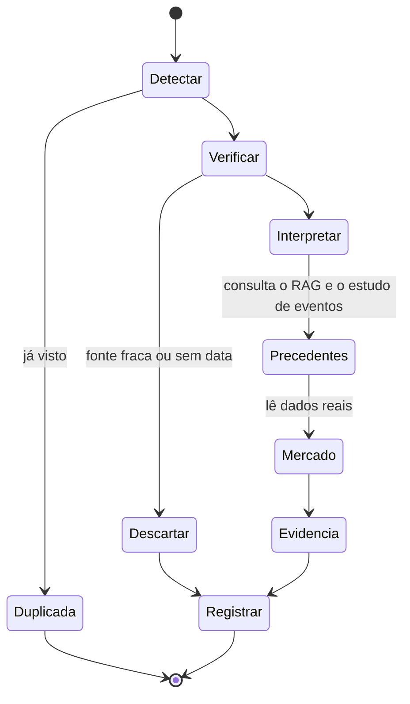
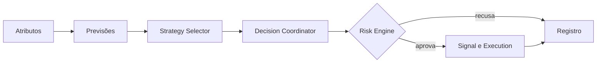

# Arquitetura multiagente

**Situação:** referência de arquitetura, subordinada ao [Product Charter](../PRODUCT_CHARTER.md). O estado real está em [RASTREABILIDADE.md](RASTREABILIDADE.md).

## Regra central

Um "agente" aqui é um **nó com responsabilidade, entrada, saída, ferramentas e critério de avaliação**. Não há conversa livre entre agentes. Só usa LLM o nó que precisa ler texto ou fazer pesquisa aberta; o restante é código determinístico, mais barato, testável e reproduzível.

## Agentes

| Agente | Tipo | Entrada | Saída | Ferramentas | Como é avaliado |
|---|---|---|---|---|---|
| Market Researcher | LLM | Tema ou ativo | Resumo com fontes, como `Evidencia` | RAG, leitura de páginas permitidas | Citação correta, conferida por amostragem |
| Technical Analyst | Código | Velas e atributos | Estado técnico: tendência, estrutura, volatilidade | `atributos/` | Testes das fórmulas; poder de previsão medido |
| Macro Analyst | Código + LLM para texto | Séries e comunicados | `Evidencia` macro | BCB, Fed, BEA, IBGE, ECB, calendário, RAG | Comparação com o evento real |
| News Intelligence | LLM com etapas fixas | Notícia nova | `Evidencia` com tipo e confiabilidade | GDELT, RSS, RAG | Classificação contra amostra rotulada; estudo de eventos |
| On-chain Analyst | Código | Dados da rede | Risco do token, concentração, liquidez | RPC, DexScreener | Comparação com o desfecho posterior do token |
| Quant Researcher | Código | Ativo, regime | Previsões e resultados históricos | Registro de modelos | Calibração e resultado fora da amostra |
| Strategy Selector | Código | Regime, mercado, estratégias habilitadas | Estratégias aptas | Registro de promoção | Melhora medida contra o uso sem seleção |
| Risk Manager | **Risk Engine, sem LLM** | `Intencao` | `DecisaoRisco` | Posições, limites | Testes de limites, nenhuma violação |
| Decision Coordinator | **Código** | Previsões, evidências, regime | `Intencao` ou "não operar" | Regra versionada | Resultado medido no simulado |
| Execution Agent | **Código** | `DecisaoRisco` aprovada | `Ordem` | `execucao/` | Slippage, falhas, duplicidade zero |
| Performance Analyst | Código, com LLM opcional para texto | Registros | Relatório e hipóteses | DuckDB, registro | Conferência dos números com o banco |

O Decision Coordinator é código de propósito: se um LLM decidisse, não seria possível medir nem reproduzir a regra. O LLM pode redigir a justificativa, mas a partir dos números decididos.

## Grafos

### Evento de notícia (caminho analítico)

A saída é sempre uma `Evidencia`, e o grafo não abre operação. As 12 etapas do pedido estão detalhadas em [KNOWLEDGE_ENGINE](KNOWLEDGE_ENGINE.md).

### Decisão (caminho rápido, fora do LangGraph)

Esse caminho é uma função Python comum: não pode depender de API externa de LLM, e o tempo é medido.

### Outros grafos

| Grafo | Gatilho | Função |
|---|---|---|
| Estudo diário | Agenda | Atualiza os estudos e prepara o relatório |
| Ingestão | Documento novo | Executa o pipeline de conhecimento |
| Revisão de desempenho | Semanal | Compara previsões e resultados e propõe hipóteses para o laboratório |

## Estado, memória e falhas

- **Checkpoint:** `langgraph-checkpoint-postgres`, para retomar após reinício sem repetir chamadas pagas.
- **Memória operacional:** estado por execução, mais consultas ao registro. Não existe memória livre que mude regras: mudança passa pelo laboratório.
- **Falhas:** tempo limite e novas tentativas em cada nó. Se o LLM falhar, o evento fica pendente e o caminho rápido segue, sem aquela evidência.
- **Teto de uso:** o LLM local consome CPU em vez de dinheiro, então há limite de execuções por hora, uma por vez, com fila e prioridade. Se o caminho rápido atrasar, o grafo espera. Numa API paga opcional, o limite também vale em gasto.
- **Sob demanda:** o LLM só roda por evento (notícia, mudança relevante de mercado, agenda ou pergunta) e nunca a cada vela. O modelo é descarregado depois de usado.
- **Saída validada:** todo retorno de LLM passa pelo contrato. Saída inválida é descartada e registrada.

## Segurança

Conteúdo externo é **dado, nunca instrução**. Uma notícia pode tentar instruir o modelo, então:

1. Os nós de LLM não têm ferramenta de ordem, nem acesso a chaves.
2. A saída é restrita ao esquema, com lista fechada de ativos e tipos.
3. Só o caminho rápido fala com a execução.
4. O LLM recebe apenas o necessário, sem segredos nem identificação da fonte de sinais.

## Critério para criar um agente

Um novo agente só entra se tiver uma saída que outro módulo consome e uma métrica que mostre se ajuda. Caso contrário, é função, ou nem precisa existir.
