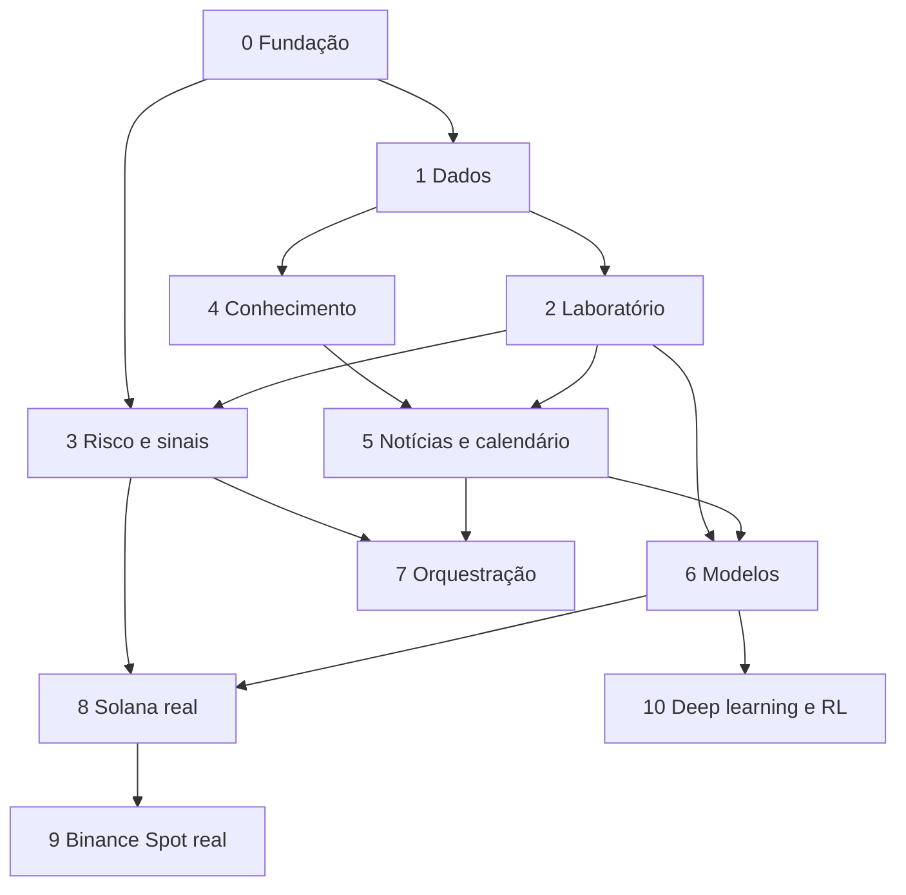

# Roadmap

**Situação:** proposta aguardando aprovação. Sem datas prometidas: o tamanho é relativo (P, M, G), e cada fase termina por critério objetivo. As fases entregam valor sozinhas, e pode-se parar em qualquer uma.

## Ordem de implementação

Definida pelo dono em 05/11/2026: construir, testar, medir e evoluir. Esta ordem manda sobre as fases abaixo, que ficam como referência de conteúdo.

| Entrega | O que funciona ao final | Critério |
|---|---|---|
| **E1** | Velas históricas e ao vivo, indicadores, tendência e padrões | Indicadores batem com o TA-Lib; nada olha o futuro; coleta recupera lacunas |
| **E2** | Coleta de trades, livro, funding e open interest | Rodando na A1, com tamanho diário medido |
| **E3** | Backtest e validação com purga e embargo; estudos refeitos | Dado embaralhado resulta em cerca de 50% |
| **E4** | LightGBM e XGBoost treinados com histórico; registro de experimentos | Comparados a referências simples, depois de custos |
| **E5** | Decision Engine, Risk Engine e paper trading por estratégia | Nenhuma sequência ultrapassa os limites |
| **E6** | Sinais com ciclo de vida, Telegram e avaliação | Todo sinal tem estado e resultado |
| **E7** | Knowledge Engine com RAG | Responde com fontes e resultados medidos |
| **E8** | Notícias e calendário, com Ollama e LangGraph | Coleta e sinais continuam com o LLM parado |
| **E9** | Ciclo de aprendizado: hipótese, experimento e comparação | Uma hipótese percorre o ciclo sozinha, até a aprovação |
| **E10** | Execução real controlada | Só com aprovação explícita do dono |

## Dependências

## Fases

### Fase 0: Fundação (P)

Tornar seguro o que já roda.

- Passar o robô do Mac para a A1, em Docker Compose com limites, com trava de instância.
- Backup diário, com restauração testada; monitor de recursos e vigia na Micro.
- Corrigir a autenticação de Configurações e preencher os limites do simulado.
- Atualizar `README.md` e `docs/robo.md`.
- Rodar testes Python no CI.

**Pronto quando:** o robô roda na A1 por 7 dias sem intervenção; uma restauração funciona; o `PUT` sem autenticação é recusado.

### Fase 1: Dados (M)

- Contratos Pydantic e Postgres.
- Migração do SQLite, sem perder o placar ao vivo.
- Coletores de trades, livro, funding, open interest, BCB, Fed.
- Log bruto em Parquet, validação, consulta "como de T".
- Registro da decisão.

**Pronto quando:** 30 dias de coleta com lacunas conhecidas e medidas; tamanho diário medido; teste de vazamento passando; uma decisão passada pode ser reconstruída.

### Fase 2: Laboratório (M)

- Backtest com custo por mercado, atraso e carteira por estratégia.
- Validação com purga e embargo; registro de todas as tentativas; DSR e PBO.
- **Refazer os estudos atuais com o método novo**, corrigindo o acerto dos traders, o viés de sobrevivência e o preço de entrada.

**Pronto quando:** os nove setups e o estudo de velas foram refeitos, com o resultado publicado em `conhecimento/`, mesmo que seja pior; o teste que embaralha o futuro dá cerca de 50%.

### Fase 3: Risco e sinais (M)

- Risk Engine com todos os limites do simulado.
- Kill switch e circuit breaker.
- Sinal com ciclo de vida, três modos e avaliação automática.
- Fluxo de confirmação no Telegram.
- Promoção por nível.

**Pronto quando:** testes de propriedade passam; kill switch testado; todo sinal tem estado e resultado; nenhum sinal sem probabilidade calibrada mostra %.

**Primeira entrega visível de valor:** sinais auditáveis no simulado.

### Fase 4: Conhecimento (P/M)

- Ingestão, pgvector, busca híbrida, catálogo de hipóteses.
- Pesquisa inicial por áreas, ligada aos testes.

**Pronto quando:** a consulta do exemplo responde com fontes e resultados medidos; em um conjunto de perguntas de teste, a busca atinge o patamar combinado de qualidade.

### Fase 5: Notícias e calendário (M)

- Ollama sob demanda, com o modelo escolhido por medição.
- Coleta com limites, deduplicação, classificação e tipos de informação.
- Calendário econômico por fontes permitidas, com surpresa medida.
- Estudo de eventos e placar de precificação.
- Eventos como atributos e como aviso, sem operação.

**Pronto quando:** classificação medida em centenas de notícias rotuladas; estudo de eventos publicado para pelo menos 3 tipos de evento; o caminho rápido não atrasa enquanto o LLM roda.

### Fase 6: Modelos (G)

- Datasets versionados; meta-labeling sobre seguir traders.
- LightGBM por mercado; volatilidade e regime; calibração; registro; drift.
- Comparação com referências simples.

**Pronto quando:** um modelo supera a referência depois de custos e da correção, no nível 2, **ou** um relatório mostra que nenhum superou. As duas conclusões encerram a fase.

### Fase 7: Orquestração (M)

- LangGraph para evento de notícia, estudo diário, ingestão e revisão.
- Checkpoints, tempos limite, fila e limite de uso do LLM.

**Pronto quando:** cada agente tem métrica; derrubar o LLM não afeta o caminho rápido; reinício retoma sem repetir chamadas.

### Fase 8: Solana com capital real (M)

- Portar o executor, com reconciliação.
- Testes de falha e uso do menor valor possível.

**Pronto quando:** todos os itens de "Antes do capital real" estão concluídos, e a diferença entre real e simulado foi medida ao longo de pelo menos 50 operações.

### Fase 9: Binance Spot com capital real (M)

- Executor, testnet e capital mínimo.

**Pronto quando:** os mesmos critérios da fase 8, com chave sem saque.

### Fase 10: Deep learning e RL (G, opcional)

- Só se houver dados e um simulador validado.
- Deve superar o LightGBM com folga, fora da amostra.

**Pronto quando:** houver relatório comparativo, adotando ou descartando.

## Prioridades

1. **Fase 0** primeiro: há riscos abertos hoje, inclusive sem dinheiro real.
2. **Dados crescem antes de modelos:** cada dia não coletado de fluxo é perdido para sempre, enquanto modelos podem esperar. Por isso a fase 1 vem logo depois.
3. **Risco antes de execução.**
4. **Se a vantagem não aparecer na fase 6, não se avança para capital real.** Essa é a saída prevista, e não um fracasso do projeto.

## O que este roadmap não promete

Não promete lucro, nem que algum modelo passará. O curto prazo é quase aleatório, conforme os estudos internos. O roadmap garante um processo para descobrir o que funciona, gastando o mínimo possível para descobrir o que não funciona.

## Próximas decisões do dono

1. Aprovar este roadmap e os critérios de promoção.
3. Confirmar o modelo local, depois de ver as medições.
4. Definir os limites de risco por mercado.
5. Autorizar o uso de créditos do provedor na A1.
