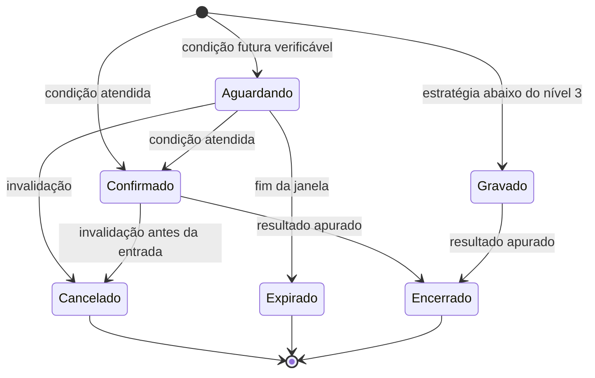

# Signal Engine

**Situação:** referência de arquitetura, subordinada ao [Product Charter](../PRODUCT_CHARTER.md). O estado real está em [RASTREABILIDADE.md](RASTREABILIDADE.md).

## Regra

Um sinal só é emitido por uma estratégia em nível 3 ou acima da [escada de promoção](MACHINE_LEARNING_ARCHITECTURE.md). Enquanto isso, ele é gravado sem envio. Todo sinal, enviado ou não, é registrado e comparado com o resultado real. **Sinais ruins não podem sumir do placar.**

## Modelo

```text
Sinal
  id, versao, estrategia, versao_estrategia, modelo, versao_modelo
  mercado, modalidade, ativo, tempo_grafico
  acao, janela_entrada_inicio, janela_entrada_fim
  preco_referencia, fonte_preco, observado_em
  condicao_entrada, invalidacao
  stop, alvo, expiracao          (somente onde a modalidade usa)
  probabilidade, calibracao_id   (vazio sem calibração válida)
  confianca_modelo, qualidade_evidencia
  justificativa, evidencias[]
  estado, criado_em, atualizado_em
  resultado, retorno_liquido, encerrado_em
```

Campos que não se aplicam à modalidade **não existem** naquele tipo. Em opções digitais não há stop, e em spot não há expiração. Cada modalidade é um modelo Pydantic próprio, evitando mistura.

## Três medidas que não se confundem

| Medida | O que é | Fonte | Quando aparece |
|---|---|---|---|
| Probabilidade estatística | Frequência esperada de acerto | Modelo calibrado e validado para aquela modalidade, ativo, tempo e horizonte | **Só com calibração válida.** Sem ela, o campo fica vazio |
| Confiança do modelo | Força relativa, comparada a outras previsões | Saída bruta do modelo | Sempre como faixa, nunca como % de acerto |
| Qualidade da evidência | Quanto sustenta a tese: tamanho da amostra, fontes | Registro e regras | Sempre |

Uma mensagem como "68%" só sai quando o registro confirma calibração válida e recente. Essa checagem é feita em código, e o LLM não tem acesso a esse campo.

## Ciclo de vida



Toda mudança de estado gera uma nova versão, sem apagar a anterior. Atualizar um sinal é criar uma versão nova; o conteúdo antigo continua disponível para auditoria.

**Agendamento:** só com condição verificável, como "se fechar acima de X até 14:05". Um horário sem condição objetiva não gera sinal.

## Formatos no Telegram

Os exemplos mostram o formato, não previsões reais.

### Opção digital

```text
SINAL · EUR/USD · COMPRA (CALL)
Horário: 14:00 · Expiração: 5 min
Referência: 1,0000 (fonte de referência, não a da plataforma)
Probabilidade: sem calibração válida
Confiança: moderada · Evidência: média (N sinais medidos)
Por quê: resumo das evidências
Cancela se: condição
Status: aguardando
```

### Spot

```text
SINAL · SOL/USDT · Spot · COMPRA
Entrada: 14:00–14:05, se condição
Stop: valor · Alvo: valor · Tempo: 15 min
Risco: 1% (Configurações)
Por quê: estratégia e evidências
Status: aguardando
```

### Regras da mensagem

- Mostra os resultados acumulados do tipo de sinal, inclusive perdas.
- Não promete lucro, nem usa "garantido" ou "certeza".
- Não cita traders nem a fonte de sinais.
- Não pede dinheiro nem recomenda valor em reais.
- Aviso de risco fixo em toda mensagem.
- Dica velha expira. O código atual já descarta dicas com mais de 10 minutos.
- "Sem oportunidade" é uma resposta válida: resumo periódico, sem gerar ruído a cada ciclo.

## Avaliação

| Modalidade | Como apura | Métrica |
|---|---|---|
| Opção digital | Direção no fim do prazo, na fonte de referência; payout real quando disponível, senão um payout conservador declarado | Acerto contra empate, com intervalo de confiança |
| Spot | Alvo, stop ou tempo, com custo real | Retorno líquido, expectativa, drawdown |
| Solana | Saída da estratégia, com custo cotado | Retorno líquido, perdas totais |

As comparações são por ativo, tempo gráfico, regime, faixa de confiança e evento macro. A curva de calibração é publicada para quem acompanha, quando houver probabilidade.

## Fluxo de confirmação

No modo CONFIRMATION, o Telegram envia o sinal com botões de aprovar e recusar para **um único chat autorizado**. A aprovação vale só para aquele sinal e tem validade curta. Depois de expirada, a ordem não sai. A aprovação nunca dispensa o Risk Engine, que reavalia com dados atuais.

## Relação com o código atual

`robo/mneme/telegram.py` continua como camada de envio, e a tabela `sinais_ao_vivo` migra para o novo registro, preservando o histórico. O grupo pago continua separado do chat operacional e só recebe sinais em nível 3 ou acima.
