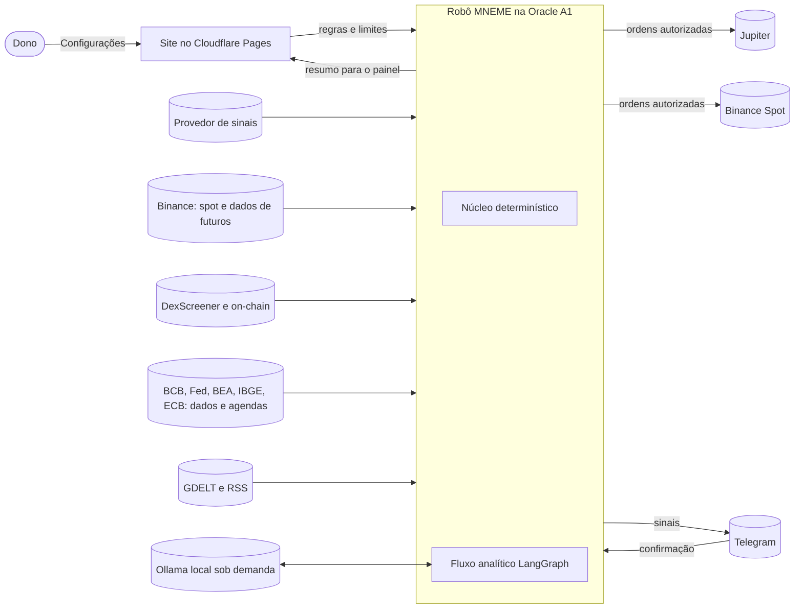
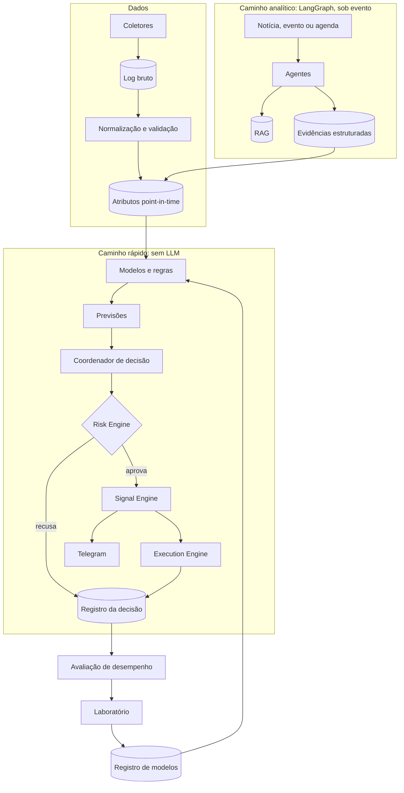

# Visão geral do sistema

**Situação:** proposta aguardando aprovação. Nada aqui está implementado, salvo quando indicado.

## 1. Objetivo

Transformar o MNEME numa plataforma que estuda o mercado, aprende com dados, entende eventos, emite sinais concretos e opera dentro dos limites configurados. O sistema também precisa reconhecer quando **não tem evidência suficiente para operar**. Nenhuma arquitetura garante lucro: ela garante que cada resultado seja medido e que uma ideia ruim seja descartada antes de custar dinheiro.

## 3. Princípios de arquitetura

1. **Núcleo determinístico, LLM nas bordas.** O LLM lê texto e devolve dados estruturados. Ele não define preço, tamanho nem direção da ordem.
2. **Risk Engine no fim de todo caminho.** É código puro, sem LLM, e nenhum agente o contorna.
3. **Cada mercado com suas próprias regras:** modelos, custos, métricas e limites nunca se misturam.
4. **Ver só o que se sabia na hora.** Todo dado leva a hora do fato e a hora em que chegou.
5. **Medir antes de acreditar.** Tudo passa pela mesma escada de promoção.
6. **Sem evidência, sem operação.** "Não operar" é uma decisão válida, registrada como qualquer outra.
7. **Crescer por módulos.** Um monólito Python em `robo/`, sem serviço novo enquanto não houver necessidade medida.
8. **Custo zero até aprovação**, na Oracle A1 (2 OCPU, 12 GB).

## 4. Contexto

A Quotex ainda não aparece como destino de ordens reais: o robô opera nela no simulado, com sinais de expiração fixa ([ADR-0015](ADR/0015-operar-forex-ouro-e-expiracao-fixa.md)).

## 5. Dois caminhos

- **Caminho rápido:** determinístico, com latência medida. Se o LLM cair, ele continua.
- **Caminho analítico:** roda em eventos e horários. A saída vira uma evidência com origem, hora e confiabilidade, que só influencia uma decisão depois que um modelo ou regra medida a tiver usado.

### Uma inteligência central, com componentes especializados

Indicadores, padrões, metodologias, modelos e documentos são capacidades compartilhadas. Nenhum deles opera nem decide sozinho, e não existe um produto separado para gráficos nem um agente por metodologia.

| # | Etapa | Componente |
|---|---|---|
| 1 | Receber dados de mercado | `dados/` |
| 2 | Identificar ativo, modalidade e contexto | Configuração por mercado |
| 3 | Analisar múltiplos tempos gráficos | `laboratorio/dataset.py` |
| 4 | Calcular indicadores | `indicadores.py` |
| 5 | Reconhecer estruturas e padrões | `leitura.py`, `metodologias.py` |
| 6 | Consultar metodologias e referências | RAG sobre `robo/conhecimento/` |
| 7 | Consultar notícias e calendário | `dados/calendario.py`, fluxo analítico |
| 8 | Avaliar as evidências com modelos | `laboratorio/previsao.py` |
| 9 | Combinar as análises | Modelo do mercado e Decision Engine |
| 10 | Determinar se existe oportunidade | Decision Engine |
| 11 | Validar riscos | Risk Engine |
| 12 | Gerar sinal ou executar operação autorizada | Signal e Execution Engine |

A combinação nunca é uma soma de pontos. As evidências entram juntas no modelo de cada mercado, que aprende com dados quais importam, quando e em que combinação. A independência entre elas é medida: uma família de evidências só ganha peso se acrescentar resultado fora da amostra. A biblioteca única fica em [`robo/conhecimento/metodologias.md`](../../robo/conhecimento/metodologias.md).

## 6. Módulos

Evolução de `robo/mneme/`, mantendo o que já existe:

| Módulo | Responsabilidade | Documento |
|---|---|---|
| `dados/` | Coletores, log bruto, validação e consulta point-in-time | [MARKET_DATA_ENGINE](MARKET_DATA_ENGINE.md) |
| `atributos/` | Indicadores, fluxo, on-chain, macro e evidências como números | [MARKET_DATA_ENGINE](MARKET_DATA_ENGINE.md) |
| `conhecimento/` | Ingestão e recuperação para o RAG | [KNOWLEDGE_ENGINE](KNOWLEDGE_ENGINE.md) |
| `noticias/` | Detecção, verificação e estudo de eventos | [KNOWLEDGE_ENGINE](KNOWLEDGE_ENGINE.md) |
| `laboratorio/` | Backtest, validação, experimentos e registro | [MACHINE_LEARNING_ARCHITECTURE](MACHINE_LEARNING_ARCHITECTURE.md) |
| `indicadores.py`, `leitura.py`, `metodologias.py` | Evidências técnicas compartilhadas | [Biblioteca](../../robo/conhecimento/metodologias.md) |
| `estrategias/` | Regras e modelos por mercado (já existe) | [SIGNAL_ENGINE](SIGNAL_ENGINE.md) |
| `agentes/` | Grafos LangGraph | [MULTI_AGENT_ARCHITECTURE](MULTI_AGENT_ARCHITECTURE.md) |
| `emissao/` | Ciclo de vida dos sinais | [SIGNAL_ENGINE](SIGNAL_ENGINE.md) |
| `risco/` | Risk Engine | [RISK_MANAGEMENT](RISK_MANAGEMENT.md) |
| `execucao/` | Simulado, Jupiter, Binance Spot | [EXECUTION_ENGINE](EXECUTION_ENGINE.md) |
| `auditoria/` | Registro da decisão e métricas | Seção 8 |

## 7. Contratos centrais

Modelos Pydantic versionados, em `mneme/contratos.py`. Os módulos só conversam por eles.

| Contrato | Campos essenciais | Produzido por | Consumido por |
|---|---|---|---|
| `Observacao` | fonte, `ocorrido_em`, `recebido_em`, ativo, carga | Coletores | Atributos |
| `Evidencia` | tipo (fato, preliminar, rumor, opinião, previsão, interpretação), origem, confiabilidade, ativos, validade | Agentes | Atributos, Decisão |
| `Previsao` | modelo e versão, mercado, ativo, horizonte, valor, `calibrada`, `corte_dados` | Modelos | Decisão |
| `Intencao` | estratégia, mercado, modalidade, ativo, lado, tamanho pedido, invalidação, evidências | Decisão | Risco |
| `DecisaoRisco` | aprovada, tamanho final, limites avaliados, motivos | Risco | Emissão, Execução |
| `Sinal` | ver [SIGNAL_ENGINE](SIGNAL_ENGINE.md) | Emissão | Telegram, Avaliação |
| `Ordem` e `Execucao` | chave de idempotência, preço limite, preenchimento, taxa | Execução | Registro, Risco |

## 8. Registro da decisão

Toda decisão, inclusive "não operar", grava: dados recebidos com o corte de tempo, notícias consultadas, atributos e versões, modelos consultados, estratégias consideradas, motivo, risco calculado, sinal emitido, ordem e resultado. Isso resolve o item M7 da auditoria e permite comparar previsão contra resultado, estratégia contra referência, versão contra versão, e o desempenho por ativo, tempo gráfico, regime e evento macro.

Aprender **não** é guardar operações boas e ruins. É usar esse registro para testar hipóteses novas no laboratório, sob as mesmas regras de validação.

## 9. Implantação

| Onde | O quê |
|---|---|
| Oracle A1 | Robô, coletores, PostgreSQL + pgvector, Parquet, inferência e Ollama, em Docker Compose ([detalhes](ORACLE_ALWAYS_FREE_DEPLOYMENT.md)) |
| Oracle Micro | Vigia externo: avisa se a A1 parar |
| Máquina do dono | Treinos pesados, se necessários; envia só o artefato do modelo |
| Cloudflare Pages | Site e Configurações, como hoje |
| Worker | Telegram e assinaturas, como hoje (legado, só correções) |

A A1 não abre portas de entrada. O site recebe resumos enviados pelo robô, sem acesso direto à máquina. Nenhum segredo fica em caminhos públicos, e o sigilo da fonte de sinais continua valendo em tudo.

## 10. O que não muda

Configurações como fonte da verdade, simulado primeiro, site no Cloudflare e legado só com correções.

## 11. Decisões

A análise crítica da visão está em [ANALISE_CRITICA](ANALISE_CRITICA.md); as decisões, em [ADR/](ADR/README.md); a ordem de entrega, em [ROADMAP](ROADMAP.md).
